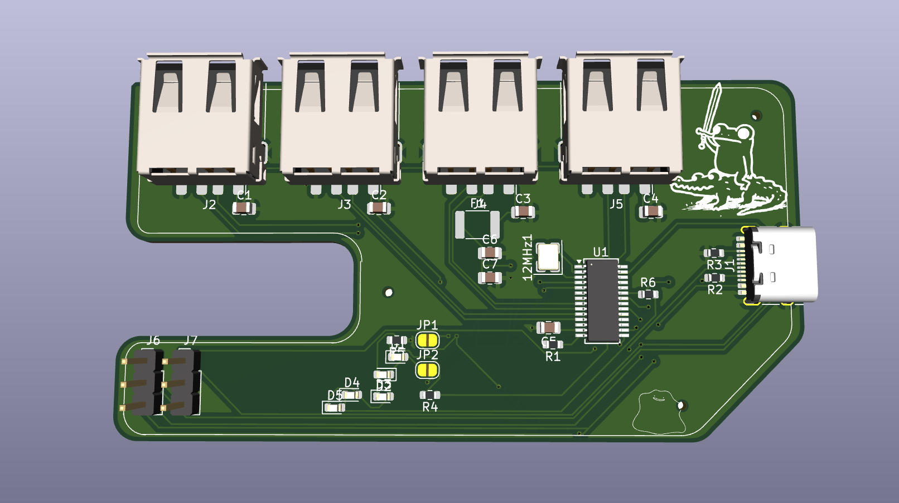
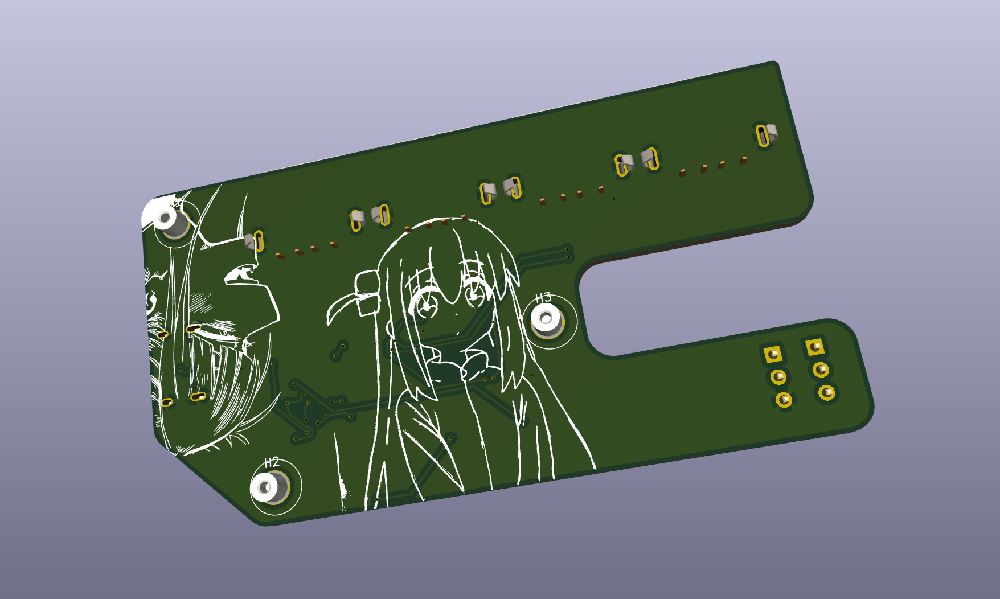
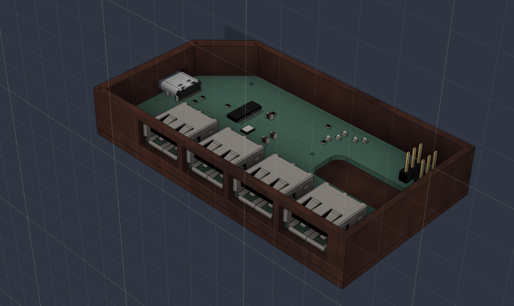
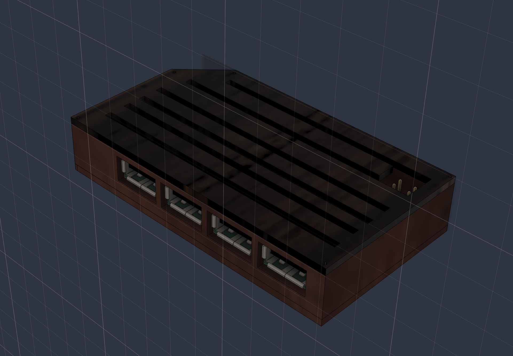
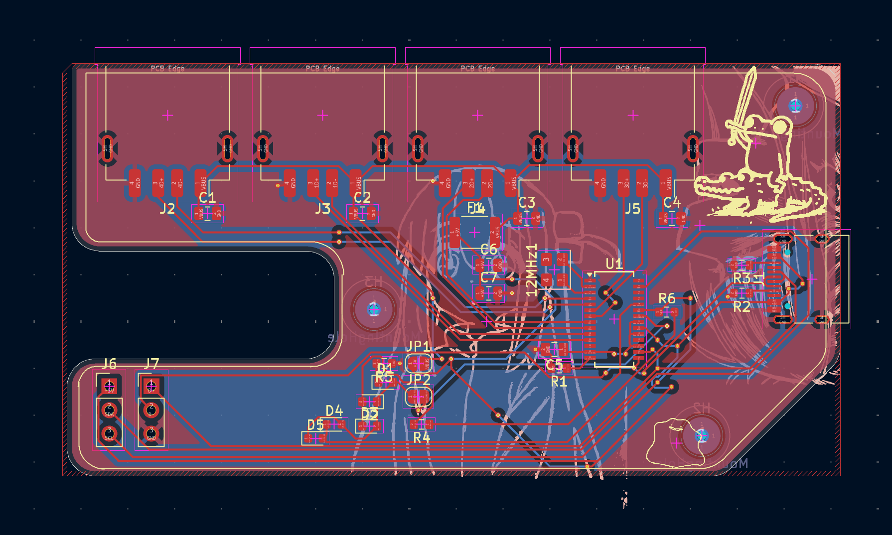
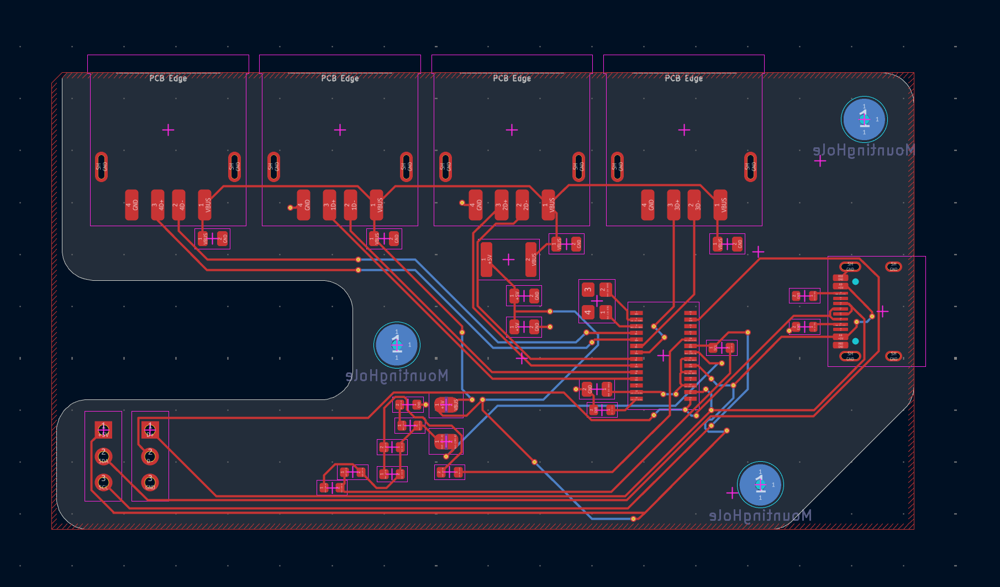
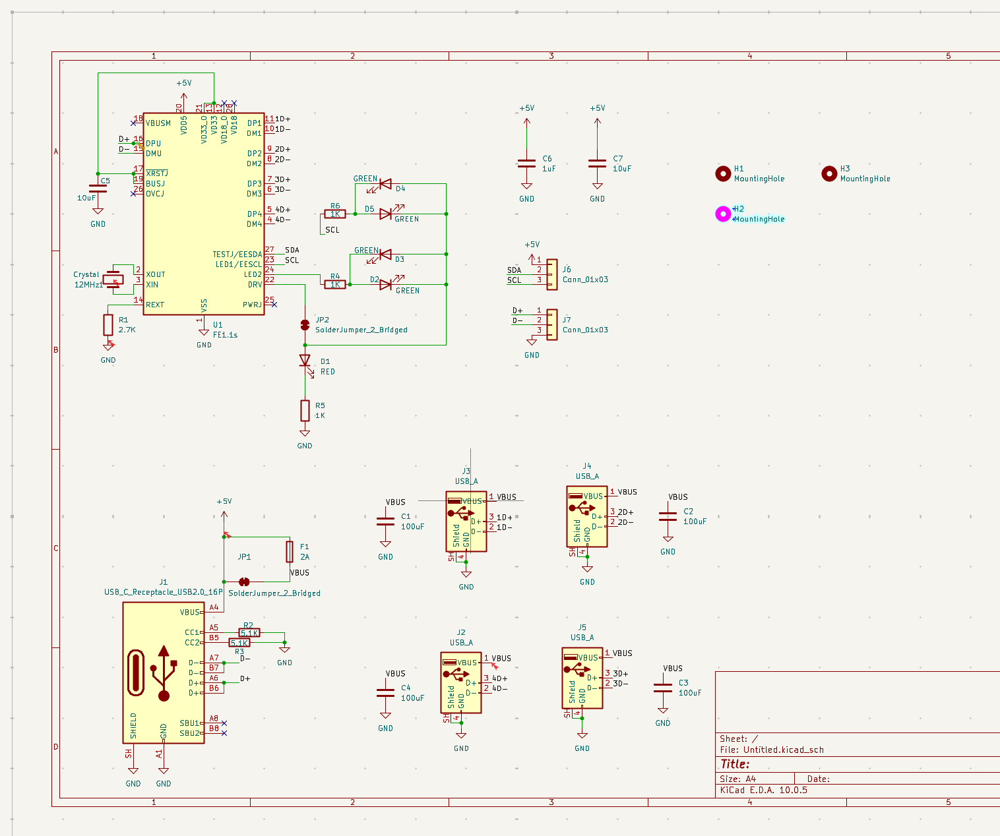

# USB 2.0 4-Port Hub

Custom USB hub design that uses the FE1.1s USB hub controller. Includes one USB-C port to connect the host computer and four USB-A ports to connect different USB devices.

This project provides you with the PCB design, circuit diagram, 3D enclosure design, and gerber files. This enclosure should be 3D printed in PLA filament, and it will have a wooden look.

## Why This Project?

In this project, a compact and custom USB hub design is planned which will expand one USB-C port to four USB-A ports.

Unlike a USB hub available for purchase off the shelf, this particular project involves designing an entire USB hub from scratch. It allows us practical experience with the design of a USB hub, integration with a USB hub controller, circuit design, and enclosure modeling using 3D printing.

The custom enclosure is planned for 3D printing from PLA with wooden look design.

## Project Images

### 3D PCB Design

**Front View**

**Back View**

### Enclosure Design

**Case Open**

**Case Clos**

### PCB Layout and Routing

**PCB Routing**

### Circuit Schematic

## Bill of Materials (BOM)

| Component Name | Quantity | Price (USD) | Purchase Link |
|---|---:|---:|---|
| FE1.1s USB 2.0 4-Port Hub Controller | 1 | $0.72 | [Buy](https://www.lcsc.com/product-detail/C42383361.html) |
| 12MHz Crystal Oscillator | 1 | $0.10 | [Buy](https://www.lcsc.com/product-detail/C518158.html) |
| USB-C Receptacle Connector 16-Pin | 1 | $0.17 | [Buy](https://www.lcsc.com/product-detail/C165948.html) |
| USB-A Female Receptacle Connector | 4 | $3.05 | [Buy](https://www.lcsc.com/product-detail/C5355659.html) |
| 3-Pin 2.54mm Pin Header | 2 | $0.64 | [Buy](https://www.lcsc.com/product-detail/C265013.html) |
| 2A Resettable PTC Fuse | 1 | $0.18 | [Buy](https://www.lcsc.com/product-detail/C315901.html) |
| 100µF 6.3V Ceramic Capacitor | 4 | $1.58 | [Buy](https://www.lcsc.com/product-detail/C141660.html) |
| 10µF 16V Ceramic Capacitor | 2 | $0.20 | [Buy](https://www.lcsc.com/product-detail/C307561.html) |
| 1µF 50V Ceramic Capacitor | 1 | $0.04 | [Buy](https://www.lcsc.com/product-detail/C28323.html) |
| 2.7kΩ Resistor | 1 | $0.002 | [Buy](https://www.lcsc.com/product-detail/C25994.html) |
| 5.1kΩ Resistor | 2 | $0.003 | [Buy](https://www.lcsc.com/product-detail/C23186.html) |
| 1kΩ Resistor | 3 | $0.005 | [Buy](https://www.lcsc.com/product-detail/C21190.html) |
| Green LED 0603 | 4 | $0.33 | [Buy](https://www.lcsc.com/product-detail/C2994781.html) |
| Red LED 0603 | 1 | $0.008 | [Buy](https://www.lcsc.com/product-detail/C2286.html) |
| 1mm Screws | 4 | $0.40 | [Buy](https://store.rc4wd.com/1mm-x-6mm-Machine-Screw-and-Nut_p_3392.html?srsltid=AYCX9vIycEosIwabGsPoTfw73K-fBxiC5gdlN2avYkQrfX3chnO0lzBLuHc) |
| PCB Fabrication | 1 | $4.00 | [JLCPCB](https://jlcpcb.com) |
| Shipping | 1 | $8.00 | — |

